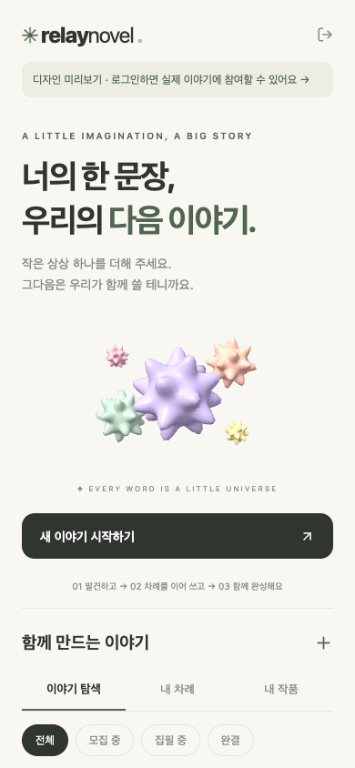

# relay novel

작은 상상들이 모여 하나의 소설이 되는 릴레이 집필 앱. 흰 바탕, 면이 보이는 입체 모양의 파스텔 열매(구·정육면체·피라미드·별사탕), 차분한 초록색을 사용합니다. 홈에는 오로지 열매와 땅만 있어서, 소설 열매가 하나씩 화면 밖 하늘에서 떨어져 흰 땅에 부딪히고, 털썩 그 자리에 멈추거나 굴러가거나 크게 튀어 다른 자리로 가서 멈춥니다. 어디에 멈출지는 홈에 들어올 때마다 달라집니다. 열매가 가까워질수록 땅의 그림자가 진해지고, 닿는 순간 살짝 눌렸다가 돌아옵니다. 열매를 누르면 그 소설의 이야기 나무로 가고, 회차 하나가 가지 하나가 됩니다. 그림은 모두 react-native-svg로 그립니다.

**Expo / React Native · iOS / Android / Web preview**




## 실행

```sh
npm ci
npm start
# 브라우저 미리보기
npm run web
```

Expo Go 또는 개발 빌드로 앱을 실행합니다. 새로고침 결제(앱 안 결제, `expo-iap`)는 결제 모듈이 든 개발 빌드나 스토어 앱에서만 되고, Expo Go와 웹에서는 앱에서 결제하라는 안내만 보여 줍니다. 열매가 떨어지는 움직임은 시스템의 동작 줄이기 설정을 따르며, 설정이 켜져 있으면 처음부터 제자리에 놓인 채로 보여 줍니다. 실제 기기에서의 그림과 움직임은 별도 검증이 필요합니다.

로그인 화면에서 **먼저 둘러보기**를 선택하면 예시 작품을 읽을 수 있습니다. 예시 작품은 7편(작가 모집 중·이어가는 중·완결, 회차 0~20개)이라 홈의 열매 자리와 상세·읽기 화면을 모두 확인할 수 있습니다. 미리보기의 작품은 샘플이며 서버에 저장되거나 발행되지 않습니다.

## 기존 백엔드 연결

[project-bookey-backend](https://github.com/project-bookey/project-bookey-backend)의 `/api/v1/novels` API를 사용합니다. 별도의 백엔드나 데이터베이스를 만들지 않습니다. 문장 다듬기는 기존 백엔드에서 서버 내부의 Bookey AI API를 호출합니다.

```sh
cp .env.example .env.local
```

`.env.local`의 `EXPO_PUBLIC_API_URL`에 기존 백엔드 주소를 입력합니다. 실제 기기에서 로컬 서버를 사용하면 Mac의 LAN IP(예: `http://192.168.0.10:8080`)가 필요합니다. 환경변수가 없으면 개발 서버 호스트에서 로컬 백엔드 주소를 추론합니다. Android 에뮬레이터에서는 필요에 따라 `http://10.0.2.2:8080`을 지정하세요. 배포 시 HTTPS API 주소를 지정하세요. 웹 미리보기에서는 백엔드 CORS에 미리보기 출처가 허용되어 있어야 합니다.

기존 Bookey 이메일 계정으로 로그인하며, 모바일 토큰은 OS의 SecureStore에 저장합니다. 웹에서는 localStorage에 보관해 새로고침해도 로그인이 유지됩니다. 토큰 갱신이 거절되면 로그인 화면으로 돌아갑니다. 액세스 토큰 만료 시 갱신 요청을 공유하고 요청을 한 번 재시도합니다.

API 타입은 현재 백엔드 `NovelDtos.java` 계약에 맞췄습니다. 백엔드 배포 주소와 테스트 계정은 포함하지 않았으며, 실서버 통합 검증은 별도로 필요합니다.

## 릴레이 흐름

1. 개설자가 공개 또는 초대 코드 방식으로 작품을 만들고 작가를 모집합니다.
2. 참가자가 신청하고 개설자가 승인합니다. 최소 2명의 작가가 모이면 릴레이를 시작합니다.
3. 현재 작가가 앞선 회차를 읽고 다음 회차를 집필합니다. 원고는 서버에 임시저장할 수 있습니다.
4. 발행 확인 후 회차를 등록하면 다음 작가에게 차례가 넘어갑니다. `turnNumber`를 전송해 오래된 차례의 발행을 서버에서 거부합니다.
5. 제한 시간 초과, 회차 제한, 완결 등 차례의 실제 판정은 기존 백엔드가 담당합니다. 앱은 `canWrite`, `canStart`, `canComplete` 등 서버 권한을 따릅니다.

홈의 열매(내 차례인 작품 먼저, 최대 7개)에서 작품으로 들어가 참가 신청, 참가 승인·거절, 릴레이 시작, 초대 코드 공유, 회차 읽기, 수동 임시저장과 발행을 할 수 있습니다. 홈 아래쪽 유리 바의 씨앗주머니(+)로 새 작품을 만들고, 열매 페이지에서 모든 작품을 상태별로 찾아보며, 마이 페이지에서 내 차례·내 작품을 보거나 초대 코드로 참가하고 로그아웃합니다. 아래쪽 바는 iOS 26 이상에서 시스템의 리퀴드 글래스로 그리고, 웹·Android·이전 iOS에서는 반투명 유리를 흉내 낸 모습으로 보여 줍니다. 시간 제한으로 집필 차례가 바뀌어도 열린 편집기의 원고를 유지합니다. 원고를 수정한 상태에서는 저장 또는 폐기 선택 후 이동합니다.

홈 오른쪽 위 새싹으로 하루 무료 2번 열매 밭을 새 묶음으로 바꿉니다. 무료를 다 쓰면 광고를 끝까지 보고 하루 3번 더 바꿀 수 있고, 광고도 다 쓰면 새로고침 한 번(`relaynovel.refresh.1`, 소모품)을 앱 안 결제로 삽니다. 광고는 아직 광고 SDK 없이 5초짜리 광고 자리 화면으로 흉내 내며(`src/components/home/RewardedAd.tsx`), 실제 광고를 붙일 때 이 화면을 바꾸고 서버가 광고 회사의 보상 확인을 받게 합니다. 결제 상품은 App Store Connect와 Play Console의 `app.relaynovel.mobile` 앱에 같은 id로 등록해야 하고, 결제 확인은 서버가 스토어에 묻습니다. 횟수 판정은 모두 서버가 합니다. 이어 쓴 열매는 홈에서 사라집니다.

신규 회원가입, 소셜 로그인, 푸시 알림, 앱스토어 배포는 아직 포함하지 않습니다. Bundle ID는 초기값 `app.relaynovel.mobile`이며 스토어 출시 전 실제 계정에 맞춰 확정하세요.

## 검증

### 글쓰기 보조

집필 화면의 **AI로 문장 다듬기**를 누르면 의미와 말투를 유지하는 수정 제안을 받습니다.
본문에서 일부를 선택하면 그 부분만 보내고, 선택하지 않으면 전체 본문을 보냅니다.
한 번에 최대 2,000자이며 긴 원고는 다듬을 부분을 선택해야 합니다. **제안 적용**을 누르기
전에는 원고가 바뀌지 않으며, 적용 후에도 임시저장과 발행은 직접 해야 합니다.
요청 후 원고를 편집하면 이전 제안의 적용을 막아 새로 쓴 내용을 보호합니다.

일반 집필 차례와 배달받은 열매의 가지 쓰기를 모두 지원합니다. 백엔드는 각 요청에서
집필 권한과 차례·배달 유효성을 확인합니다. 한도는 사용자별 분당 3회, 첫 요청부터
24시간 동안 10회이며 실패한 요청도 한도에 포함될 수 있습니다. 오류가 나도 원고는 유지합니다.

앱에는 기존 `EXPO_PUBLIC_API_URL`만 필요하고 AI 인증키나 Groq 키는 넣지 않습니다.
백엔드에는 `BOOKEY_AI_BASE_URL`과 `BOOKEY_AI_API_KEY`를 설정합니다. 운영 배포는 같은
EC2의 `/opt/bookey-ai/ai-api-key`를 읽어 내부 인증키를 연결합니다.

API 경로는 일반 집필 `/api/v1/novels/{id}/writing-assist`, 가지 집필
`/api/v1/novels/deliveries/{deliveryId}/writing-assist`이고, 요청은
`{"turnNumber":1,"text":"다듬을 글"}`, 응답은 `{"text":"다듬은 글"}`입니다.
가지 집필의 `turnNumber`에는 기존 초안 계약처럼 배달 id를 보냅니다.

### 코드 검증

```sh
npm run typecheck
npm test
npm run export
```

브라우저에서 모바일 크기로 테스트하려면 `npm run web -- --port 8083` 실행 후 `npx playwright test`를 실행합니다. 로컬 Chrome이 필요합니다. 미리보기에서 열매를 눌러 회차를 읽는 흐름, 아래쪽 바로 홈·마이·열매 페이지를 오가는 흐름과, 모의 백엔드를 통한 로그인·릴레이 시작·임시저장·발행 흐름을 검증합니다.

전송 계층 테스트는 동시 토큰 갱신, 만료 세션 처리, 로그아웃 중 갱신 완료, 집필 차례 충돌, 서버 유효성 오류를 확인합니다. Expo export는 iOS·Android·웹 번들을 생성하며 실제 기기 테스트와는 별개입니다.

```text
app/                  로그인, 홈(열매), 모집, 초대, 읽기, 집필 화면
src/api/              기존 Bookey API 계약, 요청, 미리보기 데이터
src/state/            인증 세션과 네이티브 토큰 저장
src/components/       열매와 이야기 나무 그림, 공용 UI
src/design/           이야기 나무 모양, 열매의 입체 면, 열매가 하늘에서 떨어지는 움직임 계산
src/theme/            디자인 토큰
tests/                API 전송·이야기 나무·열매 모양·열매 움직임 단위 테스트, 모바일 E2E
```
